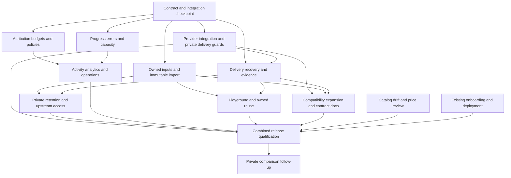

# Private generation core: detailed delivery and parallel work plan

Owner decisions updated **2026-11-04**. Planning baseline: integrated candidate `508476a`, plus separate provider-validation and onboarding/deployment work. This is a plan, not evidence that the work is implemented. It turns the [Yir audit](COMPETITIVE-GAP-AUDIT-2026-11-03.md) and [fal audit](FAL-GAP-AUDIT-2026-11-04.md) into one dependency-ordered backlog.

## Binding scope

1. **All user generations are private.** The access boundary is the owning workspace and its authorized members, API keys and agent grants under existing roles/scopes. This preserves the team product; it does not invent creator-only permissions within a workspace. Prompts, references, jobs, attempts, outputs, receipts, tags, history and comparison runs have no public listing, gallery, share/publish operation, sitemap entry or social preview.
2. **SDK distribution is deferred.** Do not build/publish new SDKs, language bindings, Vercel AI SDK/framework adapters or SDK-specific starters in this plan. Maintain the existing internal client only when needed for compatibility. The already assigned CLI/skill/plugin onboarding work continues. Developer access centers on excellent HTTP/MCP docs, discoverable schemas and executable examples using raw HTTP.
3. Public home/company/model/provider pages remain crawlable and optimized for SEO/AEO/GEO using catalog facts, sources and approved marketing assets. Private customer generations never supply public page content. The hero remains one pre-edited Hyperframe comparison clip. Preserve the approved palette and approachable retro design.
4. Keep one canonical common-plus-model-specific input contract, exact model/deployment/region identity, PostgreSQL jobs, integer accounting, explicit BYOK payer selection and conservative unknown acceptance. No Temporal migration, second generation protocol, generic expression engine or unrestricted proxy.
5. Signed owned media URLs are short-lived bearer capabilities issued after authorization. Do not promise identity-bound downloads, instant revocation of issued URLs, provider zero retention or inference residency without the corresponding mechanism/evidence.

Customer-configured webhook deliveries and exports remain authorized workspace operations, with minimized payloads and the same secret/asset handling. They do not create a public generation page or change asset visibility.

## Ownership and current evidence

| Owner                               | Scope                                                                                                                                                                                       | Boundary                                                                                                                                                                 |
| ----------------------------------- | ------------------------------------------------------------------------------------------------------------------------------------------------------------------------------------------- | ------------------------------------------------------------------------------------------------------------------------------------------------------------------------ |
| **Core integration owner**          | Shared contracts, migration allocation, engine/server wiring, branch integration, privacy/money invariants and final release candidate                                                      | One writer at a time for shared integration files; reviews focused feature branches.                                                                                     |
| **Onboarding and deployment owner** | Backend/identity deployment, secrets/runtime configuration, agent docs/recipes/discovery, CLI/skill/plugin, diagnosis/recovery, feedback/catalog requests, actual hosted/local client proof | Keep its work in progress; core packages supply stable API/error/asset contracts. Do not build another auth or onboarding system.                                        |
| **Provider-validation evidence**    | Separate branch `codex/provider-validation-20261103`, last reviewed `3c897e0`                                                                                                               | Review and integrate scoped fixes; do not replace newer integrated source with its older checkout. Source-safe report and private budget journal are separate artifacts. |
| **Feature workers**                 | The bounded packages below, their fixtures, tests and package docs                                                                                                                          | Independent branches/checkouts; no shared-checkout edits, production mutations or independently admitted paid calls.                                                     |

The last reviewed provider report has seven credential access checks, five upstream generation successes, four gateway deliveries and a manual xAI recovery. That is not complete route/region qualification. Keep unknown fal/MiniMax charges held and use the **current shared USD 50 total budget journal**, never a stale remaining-balance number copied from a document. All paid test admission has one coordinator. Do not repeat fal billing checks that the validation workstream has explicitly closed out of scope.

## C0 — Small contract checkpoint and integration baseline

**First integration task; independent research, fixtures and UI prototypes may begin immediately.**

Freeze minimal additive contracts for: trusted admission actor and private labels; generation/delivery/settlement/error state; private provider-output recovery receipts; owned input readiness/reuse; progress and price evidence; compact status/history queries. Preserve existing job IDs and generation semantics. Older rows have explicit unknowns, not fabricated attribution, immutable input hashes or fidelity.

Specify delivery readiness once for native HTTP, MCP, compatibility, customer webhooks and the browser. Customer responses contain only authorized owned output capabilities; internal provider URLs/receipts stay private. Define the metadata/idempotency rule: the original request and metadata are immutable under the same workspace key, and replay returns the original job/actor rather than editing history.

Inventory onboarding/provider branches before allocating migration numbers. **Onboarding inventory update:** this candidate already contains `013.sql` for private feedback, and that exact migration/checksum has been applied to the private hosted database. Preserve it unchanged and do not reuse its number; reconcile the central allocation map before assigning a subsequent slot. The original integrated baseline ended at `012.sql`; current core source preserves applied onboarding `013` and adds centrally allocated `014`–`021`. The migration loader uses an explicit list. Reserve each subsequent number centrally in merge order; workers prepare schema drafts/tests and never independently claim a slot. Applied migrations remain unchanged. Use additive/null-compatible upgrades, test populated old databases and update the existing loader once per integrated change.

**Exit:** reviewed request/response examples and state transitions; assigned file owners/migration slots; compatibility/privacy regression fixtures; agreed auth/asset/error seams with onboarding; scoped provider-branch integration sequence. Do not build a large speculative abstraction layer as the checkpoint.

## C1 — Provider integration and immediate delivery/privacy correctness

**Priority: release-critical. Start now against existing source.**

- Review the provider-validation commit range and selectively integrate pricing/adapter/smoke-runner fixes. Preserve newer Official author metadata, canonical H3 Max identity, account pages, regional records and approved UI.
- Fix the reproduced compatibility defect: no image HTTP success with empty `data`, no completed video whose output is unavailable. Describe pending/failed/partial/expired delivery with a stable job ID and safe recovery action; retain the independent upstream outcome and charge state.
- Require configured private output storage before generation admission/reservation/provider dispatch. Catalog/schema/quote-only operation remains possible. A later storage outage preserves accepted jobs and schedules delivery recovery.
- Remove the customer-visible no-storage fallback that currently returns raw provider outputs as `unverified`. Apply the same rule to native/MCP/compatibility reads and outbound customer events. Historical unarchived output stays unavailable to customers until safely archived.
- Review the xAI transport fix alongside provider integration; complete bounded, TLS-validated, DNS-safe gateway retrieval through the original job. Its final delivery qualification depends on C3/Q and does not block merging the initial C1 guards. Manual recovery is not an acceptance pass.

**Owned implementation:** compatibility handler/tests and reviewed provider-specific fixes. Integrator owns admission/DTO/worker hooks. **Acceptance:** failed/pending/partial/expired/no-storage matrix; no reservation or provider call when storage is absent; zero raw URL leakage; correct workspace authorization; no regeneration or repeated settlement. Combined provider changes pass exact-variant/regional fixture checks before new live tests.

## C2 — Immutable inputs and owned file lifecycle

**Parallel with C3/C5 after C0; can prototype imports and multipart fixtures immediately.**

- Extend the shared asset path for required owned audio/WebM support, bounded content validation and prepare/uploading/processing/ready/failed/expired/deleted states. Keep upload acceptance separate from model capability. Choose size/part limits from supported routes and deployed resources, rather than copying a competitor maximum.
- Add multipart initiate/part/complete/abort/resume where needed. Completion is idempotent and checks actual object facts/content; abandoned work has cleanup. Unready or foreign assets cannot dispatch.
- Claim a stable workspace/idempotency preparation identity, then import each external reference once outside database locks. Persist immutable bytes/hash, roles and order. Finalize one job/reservation only after successful input preparation and revalidation; failed imports cause no provider submit or paid reservation. Concurrent replays use the same preparation result.
- Exact media-dependent quotes use ready owned inputs; external-URL quotes disclose estimation. Admission reprices frozen inputs within the approved cap. Dispatch mints adequate bounded read capabilities without exposing storage credentials.
- Add a server-owned output-to-input reuse operation. The current upload validator accepts only input keys; do not copy an output key/expired URL into the form. Authorize the source job/asset and register or copy identical bytes into the supported owned-input path, preserving parent lineage and the existing canonical asset reference shape where feasible.

**Owned implementation:** storage/import/file-state modules and focused asset routes/tests; integrator wires admission and operation registries. **Acceptance:** mutable URL and concurrent replay retain identical hashes; changed-body idempotency conflict; private-network/redirect/size/MIME rejection; multipart interruption/duplicate completion/abort; ready-state and cross-workspace tests; output reuse is authorized and spends nothing.

## C3 — Durable delivery recovery and output evidence

**Parallel with C2/C5 after C0; isolated inspectors/crash fixtures can start now.**

- Persist a bounded private recovery receipt before downloads: original job/attempt/route/provider connection, output slot and recoverability facts. Never store a raw-response bag or expose these descriptors through customer DTOs.
- Cover adapters that currently archive before returning `ProviderResult`, including OpenAI, Google image/video and Replicate. Move recoverable descriptors/private inline-byte handling to the durable result boundary; an engine-only receipt cannot recover a response lost inside an adapter. If a provider has inline-only output and no re-fetchable task, retain bytes in bounded private durable staging where available. A crash/response loss before any durable copy may be unrecoverable: disclose that limit, preserve acceptance/cost uncertainty and never regenerate automatically.
- Use durable per-output work state, due time, lease, retry bound/expiry and a persisted deterministic owned object key. Retry missing slots only, retrieving fresh URLs from the **same upstream task** where supported. Already retained bytes are immutable.
- Reuse PostgreSQL worker claims; delivery work neither creates a provider attempt nor replays financial settlement. Duplicate callback/poll/download completion is replay-safe. Expired/unrecoverable sources have explicit terminal reasons.
- Preserve hashes/exact bytes and distinguish provider declarations from decoded dimensions, duration/audio/codec/count and signature integrity/signer trust. Use bounded, isolated native inspection where required; metadata probing is not full decode. Missing tooling/evidence stays unknown.
- Add qualified per-file conformance/fidelity decisions and safe requested-versus-delivered notices. Normalize provider invalid/policy/technical/unknown outcomes and record who checked content. Define any OpenGen moderation coverage before advertising it. An Official badge or valid signature alone does not prove model origin.

**Owned implementation:** output/delivery/inspection/provenance modules and tests; integrator owns worker/result/event hooks and coordinates affected adapters after C1 review. **Acceptance:** crash before/after download/PUT/DB commit, adapter-side storage failure/inline response loss, duplicate workers/events, partial recovery, changed attempt, expired source and storage outage; recovery adds no paid submission or duplicate settlement and retains one available object per slot, with honest unrecoverable states where bytes were lost. Test malformed/truncated/undersized/short/missing-audio outputs, bounded tool failures and C2PA evidence states. Gateway xAI delivery must pass through this path before qualification.

## C4 — Private retention and upstream access controls

**Policy/capability inventory starts now. Enforcement uses C2/C3; enable restricted upstream outputs only after authenticated ingestion works.**

- Configure private buckets and authorized issuance of owned capabilities; mark private API/app responses no-store. Audit logs, errors, traces, customer webhooks and exports for content/credential handling. Public metrics contain reviewed anonymous aggregates, never prompts, job/actor/tag identifiers or asset links.
- Specify the operational lifecycle for unfinished uploads, temporary imports, retained inputs, outputs, private receipts and logs. Finalize hosted durations with deployment configuration before publishing a retention promise; document self-host operator settings. Planning/tests do not delete real data.
- Pin assets used by admitted jobs. Deletion/expiry must not break accepted work or unrelated reuse: defer cleanup or return an explicit in-use state. Tombstone content while retaining minimal ledger/attempt/idempotency receipts. Replaying a deleted/expired job never starts another paid render.
- Add capability-backed fal payload-history opt-out, CDN expiry and output ACL mapping with an explicit recovery window. Implement provider-specific CDN token exchange, then connect it to the existing DNS-pinned downloader's host-bound credential-header support; the archive path does not yet perform this fal-specific authentication. Never send a provider API key to an arbitrary media host or forward it across redirects.
- Disclose provider retention/logging, endpoint location, inference scope and storage residency separately. Private OpenGen access does not establish supplier ZDR. An unsupported explicitly requested guarantee fails before charge.

**Acceptance:** anonymous/foreign-workspace denial across job/asset/detail/reuse/history paths; no private indexing/cache/OG content; owned link expiry/refresh behavior; accepted-use pinning and tombstone replay; restricted fal retrieval with correct host binding; unsupported privacy claims rejected; ledger correctness survives expiry. Infrastructure lifecycle configuration is deployed by the existing deployment owner.

## C5 — Trusted attribution, money limits and routing governance

**Attribution is the first slice; monthly key enforcement and attributed analytics depend on it. UI/policy fixtures start now.**

- Derive actor identity from authentication and preserve stable source key/member/grant/client IDs through native, browser, compatibility and MCP calls. The current OAuth authority projection drops attribution fields; coordinate a narrow fix with onboarding. Labels such as project/environment/feature are bounded, private and outside model input; do not forward them upstream by default or accept caller actor IDs as authority.
- Store attribution and effective policy at admission. Rotation/refresh/member removal does not rewrite history or reset the spending subject. Legacy unattributed rows remain unknown; no invented backfill to the current admin/key.
- Revalidate source key/member/grant authority and the effective narrowed policy at the authoritative reservation transaction boundary, including after input preparation. Admission cannot rely only on an earlier browser/token check; test revocation/removal racing new work.
- Add managed customer-debit monthly key caps using an explicit UTC admission-month bucket, settled charge plus held exposure. Reserve key/workspace exposure in the same transaction; settle/release once in the original bucket even across month rollover. Unknown cost/acceptance stays held. API-key-derived OAuth grants use the stable source key; unrelated member grants retain their own applicable workspace/grant policy. BYOK external charges are not falsely described as controlled by a managed-debit cap.
- Define pre-cutover cap coverage honestly for old keys; historical unattributed use is not zero. Rotate secrets atomically on the stable key ID with one-time display/hashed storage; specify and test revocation of sourced grants. Keep workspace-first lock ordering and pool-size-one behavior; no provider calls inside transactions.
- Initially measure monthly spend as gross customer debit plus held exposure. Ordinary top-ups/credits never reset a key cap. Any later refund-based quota adjustment must be an explicit, job-linked accounting rule; do not silently treat available balance as monthly spend.
- Add rename/update/archive policy operations, exact-model restrictions/provider exceptions and author-only routing using explicit author IDs. Request overrides only narrow. Preserve all regional/processing constraints on every fallback. Accepted jobs retain frozen policies/routes; archiving a bound policy never silently relaxes a key.
- Capture qualified provider usage/header evidence and accounting basis using frozen tariffs. Separate quote, reservation, customer debit, upstream cost, operator overrun and refund; unknown charge remains unknown. Preserve public list/operator-contract/private account price provenance.

**Acceptance:** native PostgreSQL simultaneous admissions, replayed submit/settlement, cap lowering race, rotation/OAuth refresh, delayed settlement/month rollover, unknown holds, legacy coverage and admin/cross-workspace policy tests. Reconcile charges to the existing ledger without double-counting attempt plus final job spend. IP restrictions and richer enterprise roles remain follow-up.

## C6 — Execution progress, structured errors and load control

**Adapter/status fixtures start now; implementation uses C0/C1 seams. Parallel sub-slices: telemetry/status and dispatch capacity.**

- Preserve available provider queued/processing phase, position and timing with observed/provider-reported origin; absent data remains null. Use bounded safe error codes/category/recovery action instead of raw bodies/logs. A retryable read error never authorizes paid resubmission.
- Provide authenticated compact job status and bounded long-poll without open DB transactions. Revision/state changes cover generation, delivery and settlement. Disconnect/timeout only ends waiting. Reuse this projection for future SSE and agent recovery.
- Enforce workspace/provider-connection dispatch limits across replicas, with bounded backlog/backpressure. Stable operator supply and workspace BYOK connection pools are separate; private credential identity is never exposed. Polling/redelivery is not another generation slot.
- Financial holds, worker leases and provider occupancy have different lifetimes. Unknown acceptance retains occupancy after a worker lease expires until evidence/reconciliation resolves it. Full capacity must not starve accepted-job polling, settlement or delivery recovery.
- Support queue-start deadlines only where enforceable. Local never-submitted expiry may release funds; a provider-reached deadline is not assumed cancellation/refund. Keep client wait expiry and inference runtime separate.
- Provider cancellation, signed upstream callbacks and status SSE are conditional later slices over the same durable transitions. If implemented, requested cancellation is not confirmed cancellation; accept late success/billing and keep poll reconciliation.

**Acceptance:** multi-worker capacity race/crash/unknown acceptance; exactly-once release; polling under full queue; deadline boundary; foreign status ID; long-poll disconnect/revocation; safe errors with unchanged money; missing progress not presented as a percentage or video first-token metric.

## C7 — Private Activity, analytics, webhook and alert surfaces

**UI/read-query fixtures start immediately. Accurate actor filters wait for C5; progress charts consume C6.**

- Cursor-paginate compact job rows using stable `(created_at,id)` traversal and documented filter/date behavior. Add model/provider/deployment/region/operation/key/status/project filters. Use parameterized indexed queries; do not load all jobs into memory or sign every asset merely to list history.
- Show ledger-backed settled/reserved/unknown amounts and private outcome/latency breakdowns. Preserve unknown legacy attribution and stable key/member labels. Separate queue/execution/delivery/end-to-end timing and material configuration cohorts; show sample counts/window. Public aggregate metrics use a separate reviewed projection.
- Expose existing customer webhook create/list/disable/secret rotation, deliveries/attempts and safe verification docs. Add bounded endpoint/event edits with explicit pending-event behavior; reuse the existing outbox and URL validation rather than building another event service.
- Expose existing active/resolved alerts, per-member read state and preferences. Add optional configured email transport with verified/opted-in recipients, durable deduplication/retries and authenticated app links. Emails contain no private prompt/media/token. Fixture email tests send nothing externally; unavailable email configuration does not block webhook/in-app UI work.

**Acceptance:** cross-workspace cursor/filter/aggregation denial; equal-time/new-record pagination; totals match reserve/settle/late/unknown fixtures; query/index plans on realistic synthetic data; one-time secret behavior; webhook rotate/disable/edit/retry/DNS safety; active/resolved dedupe and separate member unread state; no external test mail without an authorized configured test.

## C8 — Complete private Playground and result reuse

**Form work starts now from the existing schema; live reuse waits for C2.**

- Expose supported common controls and readable model-specific advanced fields from the existing registry: aspect ratio, count, named frames/references and relevant quality/options. Keep form/JSON/canonical request equivalence and exact route selection; unsupported combinations fail before spend. Preserve explicit values or explain incompatibility when changing model/operation; no silent argument dropping.
- Derive required fields from the exact model/operation rather than assuming every operation needs a prompt. JSON import is atomic: invalid input preserves the prior form. Bind quotes and asynchronous reads to workspace/model/route/operation/input/payer/cap; meaningful edits invalidate the quote and late old quote/job responses cannot repopulate changed inputs or a different workspace.
- Namespace drafts, submission receipts and job recovery by authenticated workspace/identity plus model/operation. Current keys are model-only. Clear old in-memory media on logout/workspace change and remove or safely retire unattributed legacy draft keys; never restore another workspace's private prompt/output.
- Restore copied settings without submitting. Use C2's owned-output registration path for reuse, not raw object keys/signed URLs. Validate roles/counts/quality and show expired/in-use assets honestly. Keep parent lineage private.
- Generate request examples from exactly the validated form using shared snippet primitives from the onboarding owner. No SDK dependency is required: cURL and ordinary HTTP fetch examples suffice.

**Acceptance:** desktop/phone representative image/video/reference/edit/multi-variant cases; common/advanced/JSON equivalence; exact regional pinning; reload and submit-timeout recovery; logout/workspace switch and legacy local storage; expired/foreign reuse; restoring/editing a form creates no billable work. Preserve public catalog SEO and the approved pre-edited hero.

## C9 — Compatibility breadth and docs-first API/MCP contract

**Response-matrix/docs drafts and fixtures start now. Endpoint expansion follows C1/C2/C3 readiness.**

Implement the selected OpenAI-style image edits/multipart references, bounded image response formats and Range-aware owned-video delivery as thin adapters over the canonical engine. Publish exact supported fields/status codes/extensions; reject unsupported mappings rather than silently changing aspect/quality/references. Never forward gateway credentials to storage or turn content retrieval into an arbitrary upstream proxy. Test actual HTTP 206/416 or qualified redirect behavior and bounded base64 responses.

The existing onboarding owner keeps llms/skill/model recipes, setup/discovery/doctor/recovery and client proof. Core feature owners supply schema/error/lifecycle details and source-validated examples. Together deliver:

- A short human quickstart and agent entry with configured public origin, auth/workspace choice, read-only discovery/schema/quote and clearly billable submit. No source checkout, provider key or SDK install is needed to call HTTP/MCP.
- Task guides for text-to-image, image-to-video and editing: owned input → effective schema/limits → quote/cap → stable idempotent submit → wait/resume → privately retrieve. Include interrupted waiting, unknown acceptance, delivery retry, cancellation and expired URLs.
- A per-operation field table separating common arguments, model-specific arguments, broker controls, defaults, required/conditional fields, units and exact-route limitations. Link original providers and regional evidence.
- Copyable cURL/HTTP JSON and MCP sequences, safe request files for prompts, complete response/error examples and an explicit retry decision table. Examples use synthetic public fixtures and placeholders, never production content/credentials.
- Generated OpenAPI/JSON schema/agent recipe references from the same contracts where possible. CI validates examples and schema links against the candidate and executes fixture-backed HTTP/MCP walkthroughs without paid calls. No installed SDK/package is needed for this check.

**Acceptance:** a fresh reader/agent can discover the right exact model and complete a synthetic private image-to-video journey from docs alone; invalid parameters point to the field/limit; timeout recovery uses the same job; examples have no obsolete localhost or SDK-package dependency; compatibility conformance and API/MCP authorization/state match. Hosted real-client proof remains with onboarding.

## C10 — Catalog, pricing and capability maintenance

**Independent read-only tooling/documentation can start immediately, in parallel with all runtime packages.**

Add a bounded import/diff report for supported endpoint IDs: schemas/defaults/bounds, retirement, tariff/unit/rounding and regional/capability facts. Preserve dated evidence/hash/account scope and explicitly distinguish catalog discovery from entitlement/live support. No automatic variant merging, regional cross-products or runtime promotion. Integrate existing validation formulas before extending exact request pricing through scoped, tested arithmetic; private discounts never become public list prices. A stable endpoint name is not an immutable weight digest.

**Acceptance:** synthetic upstream added/removed/changed/deprecated cases produce a reviewable diff; unknowns stay unknown; signed-off changes pass canonical/adapter/quote tests; metadata refresh cannot silently enable a route or alter accepted job snapshots. Coordinate catalog files with C1 and onboarding's discovery examples.

## Dependencies and parallel starts

Arrows gate **integration/acceptance**, not all design/testing work. The immediate C1 fix against existing contracts can land before C0; that arrow gates its new shared-contract hooks. C8 forms, C7 UI, C4 policy inventory, C9 docs and C10 drift fixtures can begin before their backend dependencies merge.

| Wave                      | Parallel work available                                                                                                                                                                                                 | Integration checkpoint                                                                                                      |
| ------------------------- | ----------------------------------------------------------------------------------------------------------------------------------------------------------------------------------------------------------------------- | --------------------------------------------------------------------------------------------------------------------------- |
| **0: now**                | C1 provider review and regression; C2/C3 input/output fixtures; C5 attribution/schema proposal; C4 privacy inventory; C8 schema-based form mocks; C9 docs/matrix; C10 catalog diff tests; ongoing onboarding/deployment | Integrator lands C0 and allocates migrations; immediate C1 guard can merge independently.                                   |
| **1: foundations**        | C2 assets/import; C3 recovery/inspectors; C5 trusted attribution; C6 telemetry/status; C7 existing webhook/alert UI; C8 form/privacy recovery                                                                           | Rebase on the contract checkpoint; integrator serializes engine/auth/server/registry hooks.                                 |
| **2: dependent features** | C4 provider privacy/retention; C5 cap/rotation/policy enforcement; C6 capacity/deadlines; C7 attributed queries/analytics/notifications; C8 output reuse; C9 protocol expansion                                         | Private receipts/assets first; attribution before key caps; recovery before private upstream ACL; no shared hot-file races. |
| **3: combined proof**     | Native-PG races/migration upgrades; API/MCP/example conformance; desktop/phone privacy/recovery; operations/failure drills; catalog qualification; onboarding's actual hosted/local client proof                        | One exact combined candidate and one paid-test admission coordinator. No fixture-to-live claim promotion.                   |
| **Follow-up**             | F comparison runs; selected cancellation/callback/SSE slices                                                                                                                                                            | Qualified core first; no SDK deliverable or new general workflow platform.                                                  |

There are more logical packages than worker slots. With four active slots, use **one integrator plus three implementers**, rotating as dependencies unblock. A useful initial implementation batch is delivery (C1/C3), assets (C2) and attribution (first C5); run C6/C4/C7 next as slots free. The integrator can perform C10 review and docs wiring between bounded core merges. The separately running onboarding chat continues independently. Waves are a capacity template, not barriers forcing every task in a row to finish before the next can begin. This plan creates no new chats.

## File ownership and merge discipline

| Shared hotspot                                                    | Single integration responsibility                                                                 | Parallel worker contribution                                                                     |
| ----------------------------------------------------------------- | ------------------------------------------------------------------------------------------------- | ------------------------------------------------------------------------------------------------ |
| `packages/contracts/src/{index,generation-types,operations}.ts`   | Canonical additive interfaces and old-reader behavior                                             | Proposed types/fixtures; no independent competing envelopes.                                     |
| `packages/engine/src/index.ts`, migration loader and numbered SQL | Admission, worker claims, ledger/cap/capacity locks, result transitions and contiguous migrations | Focused domain services/tests and exact hook patches; no broad extraction just to avoid a merge. |
| `accounts.ts`, `mcp-oauth.ts`, server auth/core wiring            | Trusted actor/grant changes with onboarding owner                                                 | Explicit permission/rotation tests and narrow changes.                                           |
| Server operation/OpenAPI/MCP registries and web relay allowlists  | One registered protocol and authorization surface                                                 | Handlers/examples with declared routes and scopes.                                               |
| Provider adapters and catalog/pricing data                        | Review validation branch first, then assign each file to one worker                               | Provider-specific mappings/receipts/tests; preserve exact variants/regions.                      |
| Web `ui.tsx`, workspace shell and shared CSS                      | Coordinate core Playground/Activity hunks with onboarding's setup hunks                           | New localized form/settings components and typed fixtures; reuse shared tokens.                  |
| Root lockfile, PLAN/STATUS/RELEASE                                | Integrator owns dependency choices and truthful combined evidence                                 | Explain necessary dependencies; never overwrite another worker's lockfile or status claims.      |

Use focused commits and private review branches. Rebase after each checkpoint; review removed as well as added behavior. SQL migrations are forward-only and existing accepted jobs must survive upgrade. Rollout enables new writes only after schema/read compatibility and backup/restore checks pass. A feature toggle may stop new admissions, never silently discard accepted work, refunds, receipts or holds.

## F — Budgeted private comparison runs, after reliable core

Select 2–4 exact models/regional routes sharing a compatible operation. Show field/role/count differences and explicit per-model overrides. Freeze one owned input package and original prompt; a common seed does not guarantee equivalent randomness across models. Quote all children, display aggregate exposure and admit/reserve the group transactionally before any dispatch. Unknown managed pricing stays ineligible. The enforced group ceiling covers managed customer debit; BYOK external charges require separately qualified provider controls and are never presented as capped by our ledger.

Persist a private run group with stable child job/idempotency identities; partial failure resumes existing children without replacement spending. Display independent phase/delivery/cost/route results side by side and support private copy/reuse. Test concurrent group admission, insufficient funds (no partial launch), crash/reload, child failure, held costs and cross-workspace access. One run is not a statistical quality/reliability benchmark. Reuse the executor; this is not a public sharing or workflow-builder project.

## Final release and managed-service acceptance

- The [publication boundary](OPEN-SOURCE-BOUNDARY.md) is explicit: original account/authentication/workspace/key/MCP OAuth/payment integration and frontend source ship with the self-hostable core, safe examples and useful operational docs. Credentials, customer generations and sensitive deployment settings stay private; no unpublished application module is required. Payment-source inclusion does not enable live payments, add auto-refill or alter OpenGen's Apache-2.0 license.
- All advertised core behavior has focused fixtures and one exact integrated source candidate passing types, catalog, tests, native PostgreSQL races, production build, browser checks, history/tree secret scans and source packaging checks. No broad repeated testing without a new change/failure to justify it.
- Upgrade a populated old database with accepted/unknown jobs, held charges, grants, webhook events and assets; verify restart, dump/restore and forward-compatible rollback. No customer data or secrets in fixtures/artifacts.
- Private access, no-storage admission, owned delivery, redelivery/idempotency, cap/capacity races and logout/workspace browser isolation pass. Public catalog HTML/metadata/sitemap remain useful and contain no customer generation data.
- Docs/HTTP/MCP walkthroughs and response/schema/error matrices agree. Setup/client qualification is owned by the ongoing onboarding chat. SDK publication is **not a release gate**.
- Provider smoke evidence is dated per advertised executable operation/region/configuration with actual gateway delivery and honest cost basis; unavailable routes stay unavailable/comparison-only. Such labels do not close an unmet original coverage commitment. If the shared cap cannot cover remaining qualification, stop paid admissions, report the precise coverage/budget gap and continue unpaid work. Output rights/human review and unknown holds remain explicit.
- Hosted identity, GCP/Vercel transport/storage/secrets and operational configuration have real evidence from deployment. Existing optional payment enablement still requires its separate sandbox/raw-webhook/exactly-once-credit proof. Provider-test authorization does not authorize customer charges.
- Final hero/media rights, source/license obligations and exact-commit CI/archive install/backup/restore evidence pass. Public release/deployment claims match completed gates; source publication and managed production readiness remain separate.

This planning change starts no product implementation, paid provider test, infrastructure mutation, package publication or new thread. The already running onboarding/deployment work continues under its existing authorization.
